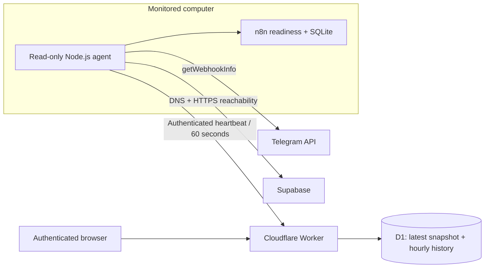

# n8n Healthcheck

**A self-hosted automation monitor whose dashboard stays available when the monitored computer goes offline.**

Built from a real troubleshooting problem: an n8n process could pass its readiness check while an active workflow had no registered webhook. A process-only uptime check missed the failure. This project combines independent health signals and pushes sanitized snapshots to an external dashboard.

JavaScript · Node.js 24 · Cloudflare Workers · D1 / SQLite · Windows Task Scheduler

## Try it without credentials

```sh
npm install
npm run demo
```

Open **http://127.0.0.1:8788**. The demo is clearly labeled and uses generated data. It makes no requests to n8n, Telegram, Supabase, or Cloudflare, and does not require a login. The red historical hour is illustrative, not a recorded production outage. Execution links use an example domain.

## Architecture



The computer initiates outbound HTTPS; the external dashboard never opens an inbound database connection. It remains reachable independently of the monitored machine. A snapshot older than three minutes is marked **unknown / disconnected**, rather than leaving old green results visible.

## What it checks

| Signal | Evidence | Limit |
| --- | --- | --- |
| n8n readiness | Local readiness endpoint | Does not prove a workflow can complete |
| Workflow + webhook | Active flag and real POST route in SQLite | Registration is not a fresh webhook delivery |
| Telegram | Expected URL and pending updates | Historical Telegram errors may remain after recovery |
| Latest bot execution | Status, failed node, sanitized error code | A successful old run is not a fresh transaction |
| n8n database | Read-only SQLite query | This adapter does not support PostgreSQL |
| Supabase | DNS lookup and HTTPS response | HTTP 401/403 proves reachability, not write access |

Hourly history stores the worst observed status and coverage metadata. Incomplete coverage is not painted green. The current hour is shown separately from historical events, and every color has a visible legend.

## Engineering choices

- **Independent failure domains:** collection runs on the computer, presentation and storage run on Cloudflare.
- **Fail visibly:** missing heartbeats become unknown; an empty webhook registry is detected even with an active workflow.
- **Low operating cost:** one latest snapshot plus six hourly aggregates, with 30-day history retention.
- **Minimal dependencies:** built-in HTTP, SQLite, DNS, fetch, Web Crypto, and Node's test runner; Wrangler handles deployment.
- **Private viewer sessions:** optional 30-day remembered login, server-side logout revocation, origin checks, and login rate limits.
- **Separate credentials:** the ingestion token cannot read the dashboard; a viewer session cannot submit agent health.
- **Accessible, responsive UI:** Thai/English text, explicit status labels, and locally bundled fonts with their licenses.

## Run against your own n8n

1. Copy `.env.example` to `.env` and supply your SQLite data path, n8n package's `node_modules` path, workflow ID, public n8n URL, and optional Supabase URL.
2. Run `npm start` and open http://127.0.0.1:8787 . The local interface is loopback-only; do not put it directly on the public Internet.
3. For cloud reporting, follow [deployment instructions](docs/DEPLOYMENT.md), then put a real `agent.json` outside this repository and set `HEALTH_AGENT_CONFIG` to it.
4. Run `npm run agent`, or install the Windows startup task described in the deployment guide.

The live collector depends on n8n's internal SQLite schema and encryption module. Explicit configuration and validation against your installed n8n version are required; demo mode has no such dependency.

## Verify

```sh
npm test
npm run build
```

Tests cover private API boundaries, real SQLite-backed sessions, 30-day and 12-hour expiry, logout revocation, password rotation, CSRF/origin handling, login rate limits, stale heartbeats, hourly history coverage, and a standalone demo HTTP smoke test. GitHub Actions runs the same checks.

## Project map

```text
server.cjs           Read-only collector and loopback dashboard
agent.cjs            60-second outbound heartbeat loop
demo.cjs             Credential-free synthetic demo
index.html           Responsive dashboard with embedded licensed fonts
cloud/worker.mjs     Ingestion, validation, D1 storage, and history API
cloud/auth.mjs       Session login, remember-me, and logout
cloud/schema.sql     Monitoring and authentication tables
cloud/login.html     Login form
docs/DEPLOYMENT.md   Cloudflare and Windows setup
SECURITY.md          Data exposure and operational boundaries
```

This public portfolio is an independently configurable copy. It contains no production domain, account IDs, passwords, n8n database, or private deployment configuration. It is not an automatic repair service or a full end-to-end transaction monitor.

## License

MIT for project code. Bundled Manrope and IBM Plex Sans Thai fonts use SIL Open Font License 1.1; see [font-licenses](font-licenses/).
